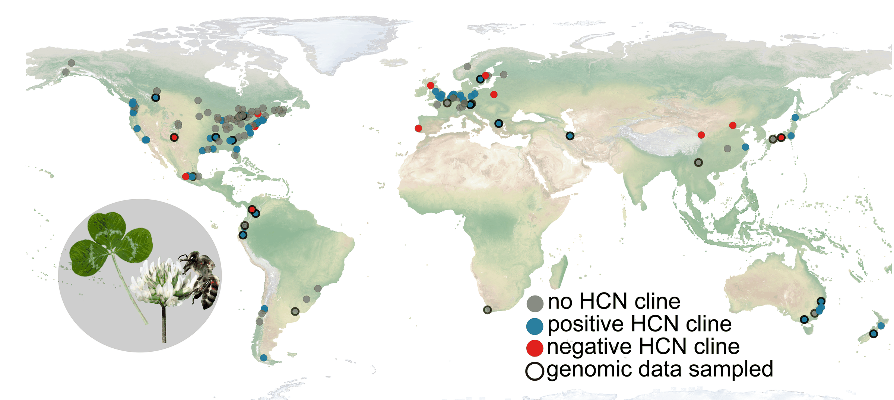
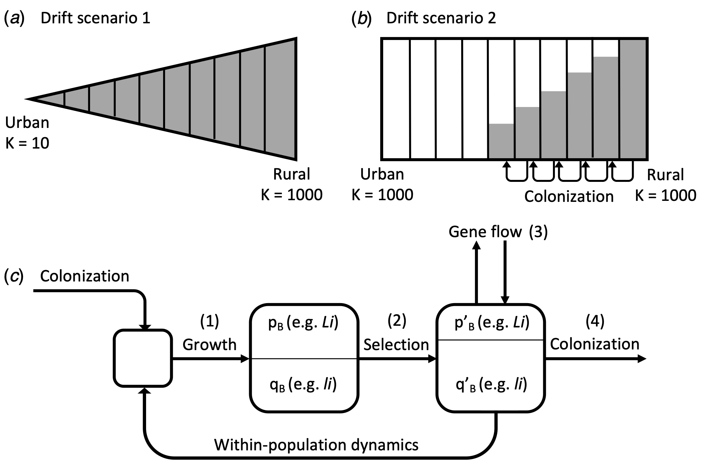

## Theme 1: The genetic architecture of adaptation to contemporary environments 

### Urban-rural cyanogenesis (HCN) clines

*Figure 1: Map of cities sampled as part of the Global Urban Evolution Project.
Cities with positive clines (HCNUrban < HCNRural) are
colored blue while cities with negative clines (HCNUrban >
HCNRural) colored red.*

Humans are having a decisive impact on natural environments around the world,
forcing species to move, adapt, or go extinct. One such form of environmental
change is urbanization and approximately 55% of the world’s human population
currently lives in cities, a figure that continues to grow annually. Similarly,
croplands and pastures currently account for about 40% of earth's ice-free
land, and anthropogenic sources of selection in these habitats can be strong
and multifarious. A major focus of our lab is to understand the genetic
architecture of plant adaptation to these heavily human-modified urban and
agricultural landscapes.

For example, we helped launch the [GLobal Urban Evolution Project
(GLUE)](https://www.globalurbanevolution.com/), a collaborative effort among
287 scientists around the world with the common goal of understanding the
mechanisms underlying [urban evolutionary change in white clover (_Trifolium
repens_)](https://www.dropbox.com/scl/fi/jhoatblsbr16r6eh34u4t/Santangelo-et-al.-2022-Global-urban-environmental-change-drives-adaptation-in-white-clover.pdf?rlkey=gb6dgskpvc1sueoc3wmf50qtg&dl=0).
In this project, we documented urban-rural clines in hydrogen cyanide (HCN)—a
plant defensive trait that also affects resistance to abiotic stressors (e.g.,
frost, drought)—in 160 globally-distributed cities. We generated a lot of data
as part of this project, which numerous projects have leveraged. For example,
[Aude Caizergues](https://audecaizergues.github.io/) used the genomic data to
explore the [demographic consequences of
urbanization](https://onlinelibrary.wiley.com/doi/10.1111/mec.17311).
Similarly, [Nic Kooyers](https://www.plantadaptation.com/), [Brandon
Hendrickson](https://louisiana.edu/directory/people/brandon-hendrickson), [Kay
Hodgins](http://hodginslab.com/), and [Paul
Battlay](https://scholar.google.com/citations?hl=en&user=QaufYW4AAAAJ) lead
efforts to examine the consequences of white clover's invasion out of the
Mediterranean to all inhabited continents, and some of the [loci underlying
adaptation in its native and introduced
ranges](https://www.nature.com/articles/s41559-025-02751-2).

### Quantitative trait evolution and genome-wide selection 

*Figure 2: Top left: Populations sampled and common garden experiment used for
detected quantitative trait differentiation of white clover populations across
an urban-rural transect in Toronto, Canada. Top right: Multivariate phenotypic
cline among Toronto white clover population. Each point represents a plant's
multivariate cline score, which combines standardized measurements of 14
phenotypic traits and their genetic correlations. Bottom: Cross-Population
Number of Segregating Sites by Length (XP-nSL) scores for urban and rural
plants in Toronto. This statistic identifies candidates of positive selection
using genome-wide haplotype data.*

Given the multifarious environmental changes associated with the development of
cities, urbanization is likely to drive differentiation in many phenotypic
traits. In line with this prediction, a common-garden experiment identified a
multivariate phenotypic cline across the city of Toronto: [urban and rural
populations were differentiated in numerous quantitative traits involved in
plant growth and
reproduction](https://www.dropbox.com/scl/fi/h63l5tsb2ca5rho8q4eni/Santangelo-et-al.-2020-Multivariate-phenotypic-divergence-along-an-urbanization-gradient.pdf?rlkey=kgb2ov6v6ohff3wgc4rdj9vfu&dl=0)
(see Figure 2 above, top), which observational data suggested might be driven
by variation in the underlying pollinator environment. Patterns of phenotypic
differentiation appear mirrored across the genome, as recent work using 120
plants from these same populations has [identified signatures of selection in
genes underlying growth, reproduction, and abiotic stress tolerance](https://www.dropbox.com/scl/fi/qrlpgrae3u4kwb8xuy3b9/Santangelo-et-al.-2025-Signatures-of-selective-sweeps-in-urban-and-rural-white-clover-populations.pdf?rlkey=hkkxuf5ha4wuj6yfs8qh8hqhc&dl=0) (see
Figure 2 above, bottom) in both urban and rural habitats.  

### Ongoing projects and questions

We have many ongoing projects leveraging diverse techniques to better
understand the traits and genes facilitating plant adaptation to rapidly
changing environments. While existing work has largely been focused on cities,
we are expanding our focus to other heavily human-modified landscapes, and to a
broader suite of traits. Here are some sample ideas we're thinking about:

1. Uncovering the genetic architecture of resistance to biotic (e.g.,
   herbivory) and abiotic (e.g., drought, frost) stressors, examining
   trade-offs among resistance strategies and pleiotropy of resistance loci,
   and the extent to which these genetic architectures are contributing to
   adaptation of natural populations.
2. Quantifying the strength of selection on complex traits in response to
   changes in underlying land-use history.
3. Examining introgression between naturalized white clover populations and
   artificially- selected cultivars that have been planted by farmers or in
   clover lawns.
4. Quantifying contemporary agents and targets of selection in multi-year
   common-garden experiments.

## Theme 2: Genome assembly, annotation, and resource development

Access to high quality molecular and genomic resources is essential to help
drive investigations into the genetic basis of adaptation, particularly in
non-model system where such resources have been historically lacking.

 

 To facilitate many of the ongoing
genomic analyses for some of the projects discussed above, it was necessary to
improve on white clover's genomic resources. In collaboration with other labs
that use clover as a model system, we developed a [chromosome-level,
haplotype-resolved assembly for _T.
repens_](https://www.dropbox.com/scl/fi/1poqinaevfnrhe74zhwpx/Santangelo-et-al.-2023-Haplotype-Resolved-Chromosome-Level-Assembly-of-White-Clover-Trifolium-repens-L.-Fabaceae.pdf?rlkey=ejl8k79e31pal06lmidb4qykm&dl=0).
In addition to a [haplotype 1](https://www.ncbi.nlm.nih.gov/bioproject/957817)
and [haplotype 2](https://www.ncbi.nlm.nih.gov/bioproject/957816), we also
generated a [functionally annotated, haploid mapping
assembly](https://www.ncbi.nlm.nih.gov/datasets/genome/GCA_030408175.1/), the
[annotation pipeline for which is
publicly-available](https://github.com/James-S-Santangelo/dcg) and has been
used on assemblies for other species with some success (though some
modifications are necessary). 
 

### Ongoing projects and questions

In collaboration with [Yaseen Mottiar](https://mottiar.uottawa.ca/), we are
developing and annotating, haplotype-resolved, chromosome-level assembly of
Eastern Leatherwood (_Dirca palustris_) to drive future investigations into the
unusual lignification process in this system. _D. palustris_ has half the
lignin of typical plant species and flexible stems as a result, which was used
as rope by indigenous peoples and early settlers in Canada. Similarly, we are
collaborating with [Carole Yauk's lab](https://caroleyauk.weebly.com/) to
develop a reference genome of the North American Herring Gull (_Larus
smithsonianus_), which we will leverage to understand how changes in pollution
levels in Hamilton Harbour—a heavily contaminated industrial waterway in
southern Ontario—have impacted somatic and germline mutation rates and spectra.

All of the projects described so far have used a single reference genome.
However, this can introduce biases in analyses, particularly in complex plant
genomes like white clover that are loaded with repeats and structural
rearrangements. A focus of the lab going forward will be to add to the growing
number of chromosome-level assemblies in white clover, which will open the door
to pangenomic analyses to help reduce reference bias and drive investigations
into the structural complexities of plant genomes. 

### Neutral clines in traits with non-additive genetic architectures 

HCN exhibits duplicate-recessive epistasis (or complementary epistasis),
whereby plants require a functional allele at each of two interacting loci to
produce HCN. Recessivity at either locus (or both) results in the inability to
produce HCN due to the absence of one of the precursors. Because of this
non-additive genetic architecture, population of _T. repens_ may be
particularly susceptible to decreases in HCN frequencies via drift alone, since
the only way for HCN frequencies to drift upwards would be for the frequency of
the functional alleles at both loci to drift upwards. During my PhD, I
simulated the evolution of clines in HCN under gradients with varying strength
of genetic drift, selection, and levels of gene flow to examine how these
mechanisms interact in the evolution of clines in traits with non-additive
genetic architectures. We found that [drift on its own is sufficient to drive
the deterministic loss of HCN in strongly-drifting
populations](https://www.dropbox.com/scl/fi/e43ppzkpwp043fl5r9h9s/Santangelo-Johnson-Ness-2018-Modern-spandrels-the-roles-of-genetic-drift-gene-flow-and-natural-selection-in-the-evolution-of-para.pdf?rlkey=897yvckmsumwpbt0ncloj0nvz&dl=0).
This could explain the frequently observed loss of HCN in urban populations,
which experience stronger drift in many systems. However, the strength of
observed phenotypic clines are far stronger than those generated via drift
alone, and genomic analyses have ruled out drift as a likely explanation
driving these clines.

